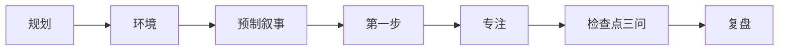

# 主动降智｜专注与执行清单

把开始前的选择写成下一步动作，减少执行时反复权衡；每段结束后用记录回看真实进展。



**入口：** 桌面 Electron（`npm start`）｜单 HTML 浏览器（打开 `app/index.html`）。

**不配 Key 也能用：** 手动创建任务和执行点、专注计时、预置或自写提示语、结束三问、记录与证据回顾。AI 功能需要自行配置 DeepSeek Key。

<!-- TODO: screenshot docs/media/focus.png -->

## 功能

- **规划与环境：** 手写阶段任务、执行动作、完成标准和检查分钟数；可选让 AI 起草清单及环境建议，检查后再保存。环境建议目前没有独立的后续展示入口。
- **预制叙事与第一步：** 内置提示语可切换或隐藏，也可自写；执行点可写成能直接动手的动作。启动未成功时，可记录尝试或放弃。
- **专注：** 当前执行点、提示语和计时集中在专注界面；到点会提示，仍可继续，结束时再回答问题。
- **检查点三问：** 结束时记录计划是否遇到新信息、实际进展或卡点、下一步；提前结束时还会询问原因。专注记录可由用户标记为进步证据。
- **复盘：** 记录页支持每日反思、随手记和专注记录；回顾页展示证据、统计和时间图表。AI 可选生成周回顾，只依据用户记录起草。
- **AI 边界：** AI 可起草执行清单、可选生成周回顾（只依据用户记录）；两项都需自配 DeepSeek Key。生成结果由用户查看和确认。

## 方法来源

方法来自作者本人知乎长文《一个奇怪的自律方法：主动降智》。本文不复录原文。

<!-- TODO: 知乎链接 -->

## 5 分钟无 Key 体验

使用浏览器打开 `app/index.html`，按 [无 Key 演示路径](docs/demo-walkthrough.md) 操作。建议在隐私窗口中体验，避免覆盖个人浏览器数据；流程不依赖 `loadDemo`。

## 运行与验证

```sh
npm ci
npm start
```

- `npm test`：运行 Node 内置测试，不启动 Electron 窗口；GitHub Actions 还会检查 `main.js` 和 `preload.js` 语法。
- Electron 冒烟检查：PowerShell 中运行 `$env:SMOKE='1'; npx electron .`。它会创建应用窗口，启动成功后自动退出并打印 `SMOKE_OK`。
- 人工界面验收尚未完成；Windows 安装包也尚未验收。
- 浏览器版数据保存在当前浏览器的 `localStorage`；桌面版数据保存在 `%APPDATA%/主动降智/jiangzhi-data.json`，设置页可导入/导出。浏览器直接打开文件时，DeepSeek 请求可能受跨域限制；通知也受浏览器权限和页面运行状态影响。
- Key 需用户自行配置。桌面版使用 Electron `safeStorage` 加密保存在用户数据目录；浏览器版在 `localStorage` 明文保存。新导出不包含 Key，历史导出或旧备份可能包含明文 Key；导入时保留当前设备 Key。

## 技术说明 / 我怎么做的

前端是零框架的单文件 HTML/CSS/JS；Electron 管理主窗口、桌面组件和课表窗口，通过 IPC 同步状态，并以 `safeStorage` 保护桌面凭据。自动化检查使用 `node --test`，由 GitHub Actions 执行。我用 AI 编程工具（vibecoding）协助开发。
